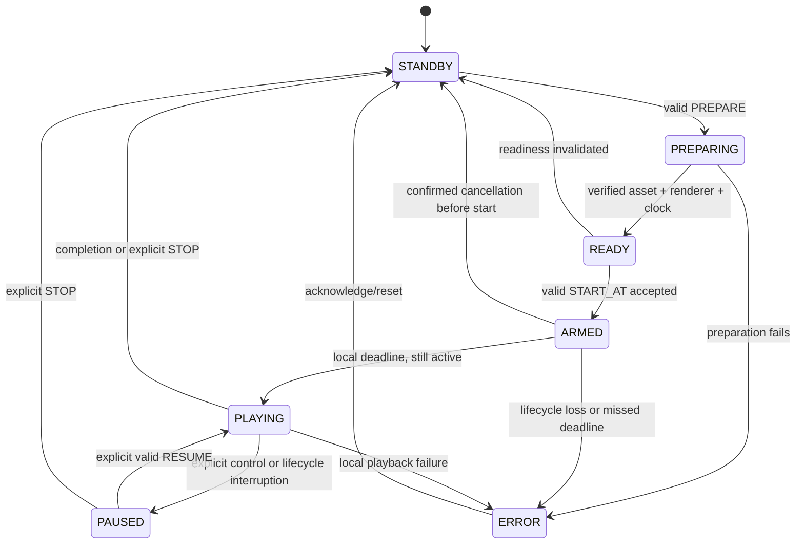

# VR headset management — technical development plan

Status: development blueprint; application implementation has not started. Requirements below reflect the agreed operator workflow. Library selections, tuning values, and internal API names are proposed implementation decisions until validated by the feasibility milestones.

## Confirmed requirements

- Deliver two APKs: an Android tablet controller and a Meta Quest 3 player.
- Initially support four headsets, without hard-coding that limit.
- Support multiple video layouts, including 360-degree and stereoscopic content, and high-resolution video.
- Target less than 200 ms difference in playback start between headsets, with individual headset audio.
- Headsets are used concurrently during a synchronized content experience and may leave Wi-Fi coverage while it plays. Playback must continue independently from local storage after a coordinated start.
- Import videos on the tablet and transfer them to headset storage before playback.
- Operate on venue/managed Wi-Fi without requiring an external service; direct device communication is possible, but discovery and reachability must be tested on the venue network.
- Allow headsets to be launched in advance and left unattended; users wear them when playback begins.
- Allow the operator to select participants for each run, defaulting to all online headsets.
- An operator presses Start on the tablet when participants are ready. Videos already contain the experience countdown; play it intact from the beginning. No physical trigger or equipment integration is required.

The 200 ms limit applies to initial playback. Ongoing alignment and drift correction are outside the initial scope; natural playback drift is acceptable unless experience testing establishes a further requirement. Start alignment is a hardware acceptance target, not a guarantee established by the design alone.

## Reference code and proposed stack

The `Forest` and `Lava_world` projects under `/Users/dan/Downloads/AndroidStudioProjects` locate `VR_8K.mp4` and launch an external player using `ACTION_VIEW`. They do not own rendering or playback timing. Their README descriptions differ from the current source, and the reference directories contain no actual video files.

Build an embedded player so the headset APK owns standby, decoding, preparation, scheduling, playback position, and completion. Proposed stack: Kotlin, Meta Spatial SDK and Media3/ExoPlayer for the headset; Kotlin and Compose for the tablet. Validate this choice with representative content first.

Use the existing `vr-controller/` and `vr-headset/` directories for application modules, with a shared protocol module and a common Gradle build if compatible with the selected SDK tooling. Preserve the original reference projects.

## Operator workflow

1. Import a video into the tablet library. Record its title, projection, stereo layout, duration, codec, resolution, and checksum. Allow manual correction of projection/stereo metadata.
2. Distribute it to selected headsets. Show download progress, available storage, missing content, and errors per headset. Retain offline devices in the device list and offer queued transfers on reconnection.
3. Create a run. Initially select all currently online headsets; the operator can change the selection. Freeze the participant list when preparing the run; later arrivals do not silently join.
4. Prepare the selected video on all selected devices. Distinguish online from ready: readiness requires verified content, supported decoding, a usable playback surface, suitable clock synchronization, and an active headset application.
5. Enable Start when every selected participant is ready. If a selected device is unavailable, show the reason and let the operator wait, retry, or remove it explicitly.
6. The operator presses Start when participants are ready. Schedule playback from media position zero with a short coordination lead time, initially about two seconds and subject to hardware testing. During that delay, retain the headset standby scene and show a brief starting status on the tablet. At the scheduled time, reveal/play the video and its audio, including its existing countdown; do not add a second participant-facing countdown or skip any of the recorded countdown. Show start-command acknowledgements separately from observed playback reports. The staging/start area must provide connectivity for preparation and command delivery.
7. Each headset executes its accepted start locally and plays the complete video without needing Wi-Fi or the controller. Return to standby locally after completion, even when offline.
8. Provide pause, resume, restart, and stop-to-standby controls for reachable devices. Show unreachable participants and per-device acknowledgements; never imply that a control reached an offline device. Do not queue playback commands for later delivery when a participant returns.

Run policy: losing Wi-Fi does not pause any headset, cancel an already accepted scheduled start, alter playback speed, or seek the video. Reconnection only reconciles status; it does not restart or resynchronize playback. A headset that missed the start stays in standby and does not automatically join late. There is no pause-group-on-disconnection option because coverage loss is expected during the experience.

The tablet shows disconnected participants as out of contact, with last-seen time and last confirmed playback state. It may show an explicitly estimated progress position but must not present it as live confirmation. On reconnection, receive the actual run ID, playback state/position, and any locally recorded completion or error result.

## Local discovery and connection

- The controller advertises a service through Android NSD/mDNS and accepts persistent WebSocket connections initiated by headsets.
- A headset discovers the controller, registers its persistent installation ID and friendly name, and reports content inventory, capabilities, battery/storage, application state, and playback status.
- Initial pairing associates a headset with a controller using authenticated credentials. Discovery alone does not authorize commands. Subsequent connections are automatic; multiple controllers must not compete for a player.
- Headsets retry discovery if launched before the tablet and reconnect after network changes. Heartbeats detect stale connections.
- Provide manual controller address entry as a discovery fallback, and a connection test that distinguishes discovery failure from inability to reach the tablet.
- Verify Android networking permissions against the tablet's actual OS and the headset's Horizon OS; they need not share the same Android version.
- If venue Wi-Fi blocks device-to-device traffic, use an allowed local network/hotspot or obtain a network configuration change. Manual addresses and a cloud registry do not bypass client isolation.
- Defer a Cloudflare registry unless local discovery proves insufficient. A registry can exchange addresses, but a relay for blocked local traffic would be a separate design and scope decision.

## Content and video support

Videos remain outside the APK. The tablet serves authenticated, resumable downloads; headsets download to temporary files, verify size/checksum, and promote only complete files into the playable library. Match content by ID and hash, not filename. A complete local file is required before readiness; no streaming, partial-download playback, or network-dependent media resources are permitted for an experience. Limit transfer concurrency and defer transfers on a headset while it is playing.

Planned presentation modes: flat, 180-degree, and 360-degree equirectangular video; mono, side-by-side stereo, and top/bottom stereo where applicable. Validate eye order, projection, and aspect ratio with known samples. Unusual projections require explicit support rather than automatic assumptions.

High resolution is not a single compatibility category. Qualify codec, profile, bit depth, dimensions, frame rate, and bitrate combinations on Quest 3, including representative 8K content. Report unsupported combinations clearly. Tablet transcoding is outside the initial scope; identify any required preprocessing after sample validation.

Content management includes import, metadata editing, distribution, inventory, and deliberate removal of app-managed copies. Never delete unrelated headset files. In-use content must not be removed mid-session.

## Start synchronization and independent playback

- Estimate each headset's offset and uncertainty relative to the controller using repeated round-trip timestamp exchanges and monotonic clocks during preparation. Refresh estimates before each run and after reconnect/resume; no clock updates are required during playback. Do not depend on internet time or matching wall clocks.
- Model each run with a unique session ID, fixed participants, content hash, initial media position, scheduled start, and a generation number. Give commands unique IDs so retries are idempotent and superseded commands can be rejected.
- Prepare media while keeping the standby scene visible and audio silent. Report readiness only after decoder/surface preparation and clock checks.
- For each new run, reset to media position zero and hold playback there until the accepted deadline. Preparation must not consume, reveal, or audibly play the embedded countdown. Switch from standby to video at the scheduled start, with synchronized audio onset. The short coordination lead time precedes the media countdown and is not part of the video timeline.
- Schedule playback at a future controller timestamp translated to each device's clock. Each player acknowledges acceptance only after arming its local schedule. Once accepted, start execution does not depend on a heartbeat or another network message. Missing acknowledgements produce an uncertain-start state for the operator; do not automatically reschedule while some players may already be armed. A network partition can prevent cancellation delivery, so the UI must not claim atomic group start or guaranteed cancellation.
- Reject expired starts and commands from previous runs. Invalidate readiness when the app pauses, loses its playback surface, or resumes with stale synchronization.
- An accepted near-future start survives network loss, but not process restart or loss of playback readiness. Do not replay a saved start after wake/relaunch. A late/missed deadline is an error, not permission to start at an arbitrary later time; establish the acceptable scheduling lateness within the measured 200 ms start budget.
- After starting, run the local media clock independently at normal speed through completion. Do not require controller leases, continuous status delivery, drift correction, or periodic playback authorization. Buffer a bounded run-result log locally for later reporting.
- Remote controls operate only on reachable devices and expire promptly; no automatic catch-up, seek, or replay on reconnection. A controller restart creates a new authority epoch and reconciles reported player state without interrupting an existing local run. Require an operator action before starting a new run.

Internal player timestamps are diagnostic evidence, not proof of physical display alignment. Measure visible frames and, where practical, emitted audio during hardware qualification.

The operator initiates video playback when participants are ready; the countdown is part of the recorded experience. The video-start protocol does not control or confirm any physical event, and no external sensor integration is planned. Remote playback controls cannot be relied upon while a headset is out of network coverage.

## Standby, sleep, and recovery

Use a calm immersive standby scene with a short waiting message and unobtrusive device identity/connection status. Never autoplay on launch, reconnection, or wake.

An unattended Quest may sleep or suspend its application. Treat that as a normal lifecycle event; do not assume a normal APK can remotely wake it or remain active indefinitely. When worn again before a run, reconnect, refresh clock estimates, restore the standby scene, and prepare the selected content before reporting ready. If sleep interrupted an existing run and the process survived, preserve it as paused and require an explicit operator action; after process death, enter standby and report interruption. The controller must distinguish online, preparing, ready, playing, paused, and unavailable states without claiming to know a disconnected device's exact physical state.

Keep the controller screen awake during an active operator session. Determine any background-service requirements from actual tablet lifecycle tests rather than assuming Android will keep the local server running after suspension.

## Technical architecture and module boundaries

Use one Gradle repository with two application modules and two small JVM libraries. Share protocol and deterministic timing/state logic; keep Android rendering, persistence, and networking adapters in their owning application initially.

```text
vr-device-control/
  settings.gradle.kts
  build.gradle.kts
  gradle/libs.versions.toml
  gradlew, gradlew.bat, gradle/wrapper/
  shared-protocol/       # wire DTOs, versions, validation, error codes
  shared-domain/         # clock estimator, state reducers, command deduplication
  vr-controller/         # tablet APK
  vr-headset/            # Quest APK, immersive scene and local player
  docs/                  # qualified media matrix, protocol, deployment/runbook
  test-fixtures/         # small synthetic clips/manifests; no large production videos
```

Dependency direction: both applications depend on `shared-domain` and `shared-protocol`; `shared-domain` may depend on `shared-protocol`. Neither library depends on Android, Compose, networking implementations, or the Meta SDK. Only `vr-headset` depends on the Meta SDK. Avoid introducing a dependency-injection framework initially; constructor injection and explicit application composition are sufficient.

| Area | Proposed implementation | Verification before committing |
| --- | --- | --- |
| Tablet UI | Kotlin, Compose, ViewModels, immutable `StateFlow` models | Landscape layout and lifecycle on the actual tablet |
| Immersive player | Meta Spatial SDK scene with Media3/ExoPlayer feeding a video surface | Projection, stereo, 8K decoding, first-frame behavior, tracking/lifecycle |
| Protocol | Kotlin serialization, versioned JSON over WebSocket | Unknown fields, version mismatch, size limits, duplicate delivery |
| Tablet server | Embedded Kotlin/JVM server behind `ControllerTransport`; evaluate Ktor and an engine with Android-compatible TLS/WebSocket support | Actual Android runtime, TLS, concurrent large transfers, shutdown/rebind; desktop JVM support alone is insufficient |
| Headset client | OkHttp WebSocket/HTTP adapters | TLS pinning, resume downloads, Wi-Fi changes, reconnect cancellation |
| Persistence | Room for catalog/devices/runs/transfers; DataStore for preferences | Schema migrations, crash recovery, no replay of transient state |
| Concurrency | Coroutines with explicitly owned scopes; serialized session reducer | Network failure cannot cancel playback or an armed deadline |
| Build | Pinned version catalog, Gradle wrapper, dependency verification | Compatible AGP/Kotlin/JDK/Meta SDK/Media3 tuple; no floating versions |

Meta's [media-player sample](https://developers.meta.com/vr/documentation/spatial-sdk/spatial-sdk-sample-mediaplayer/) establishes an integration reference for ExoPlayer and immersive stereo video, not a guarantee for every input format. The [Ktor engine matrix](https://ktor.io/docs/server-engines.html) does not establish Android compatibility; the server/TLS spike is an explicit decision gate.

Determine `minSdk`, `compileSdk`, and `targetSdk` separately for each APK from the selected SDK requirements and deployed devices. Record the exact tablet and Horizon OS versions; do not treat “latest Android” as a headset OS requirement. Use distinct application IDs, ARM64 for Quest, and separate release signing identities or a documented shared signing policy. Retain signing keys outside the repository. Deliver ordinary sideloadable APKs; store distribution is not in the initial scope.

### Application services

| Owner | Component | Responsibility |
| --- | --- | --- |
| Controller | `ControllerHost` | Server lifecycle, NSD advertisement, authenticated connections |
| Controller | `DeviceRegistry` | Persistent identities, last-seen snapshots, connection generations |
| Controller | `CatalogRepository` / `ContentServer` | Import, metadata, immutable media objects, authenticated byte-range serving |
| Controller | `TransferCoordinator` | Per-device queues, retries, concurrency and storage checks |
| Controller | `RunCoordinator` | Participant snapshot, readiness barrier, start scheduling, acknowledgements |
| Headset | `ControllerConnection` | Discovery, pairing, reconnect, inbound validation; no player ownership |
| Headset | `LocalContentRepository` | Downloads, checksum verification, verified-file inventory |
| Headset | `HeadsetSessionCoordinator` | Serialized command/state transitions and readiness generation |
| Headset | `ClockSynchronizer` / `StartScheduler` | Offset estimation, deadline conversion and local execution |
| Headset | `PlaybackEngine` | Prepare, play from zero, explicit controls, completion/error events |
| Headset | `ImmersiveScene` | Standby/video visibility, projection, stereo, lifecycle signals |
| Both | `RunJournal` | Bounded durable results and exportable diagnostics |

`PlaybackEngine` is our adapter, not an SDK class. Its contract should expose `prepare(verifiedAsset, presentation)`, `arm(localDeadline)`, `pause()`, `resume()`, `stop()`, and typed events. Keep scheduling policy testable outside the SDK adapter; all actual player calls execute on the player's configured application looper. No socket callback calls the player directly.

## Persistent data and identifiers

Use generated installation UUIDs, not hardware serial numbers or IP addresses, for identity. Names such as “Headset 1” are editable labels. Use UTC only for human-readable audit timestamps; synchronization uses monotonic time.

| Record | Key fields and invariants |
| --- | --- |
| `Device` | `deviceId`, name, paired controller ID, app/protocol version, capabilities, last-seen UTC; connection state is ephemeral |
| `MediaAsset` | Asset UUID, SHA-256, byte count as 64-bit integer, local object path, container, streams, duration, dimensions, bitrate/frame rate where available |
| `Presentation` | Asset ID, revision, projection, stereo layout, eye order, aspect/FOV settings and initial orientation; a metadata edit changes revision |
| `DeviceAsset` | Device ID + content hash, verified bytes, capability result, verification time; a filename match is insufficient |
| `Transfer` | Transfer ID, device ID, hash, total/committed bytes, temp path, state, retry count and error |
| `Run` | Run UUID, controller epoch, selected asset/hash/presentation revision, frozen participants, scheduled time and outcomes |
| `RunParticipant` | Run/device IDs, process instance, preparation token, ready/accepted/observed/completed timestamps, latest status and failure reason |
| `RunEvent` | Device/process/run/event IDs, monotonic timestamp, local sequence, type, error/detail; idempotent upload |

Persist metadata, verified assets, pairing material, transfer checkpoints, and result history. Do not persist a runnable start timer, `READY`, or a live connection as recoverable authority. On process launch, mark unfinished local runs interrupted and enter standby. Preserve a bounded deduplication journal for durable operations, but old process/epoch commands are rejected before dispatch.

Store pairing secrets using Android Keystore-backed protection and exclude credentials, device identity, and transient scheduling state from backup/restore. Restoring a copied identity onto another headset must not create two devices with the same credentials. Media files live in app-specific storage, not cache directories; explain that uninstalling the app removes its managed copies.

## Discovery, pairing, and transport contract

### Connection lifecycle

1. Start the controller server on the Wi-Fi interface, obtain its bound port, then advertise an application-specific DNS-SD service such as `_vrctrl._tcp.`. TXT records carry only controller ID, protocol major version, and display name; no secrets.
2. Headsets discover services through `NsdManager`, filter for their paired controller, and resolve current address/port. Before pairing, show available controllers rather than selecting an arbitrary one.
3. Connect using TLS/WSS and authenticate, then exchange `HELLO`/`WELCOME`. Register the current process instance, capabilities, inventory summary, and any unfinished/result records.
4. Use heartbeats and network callbacks to update connectivity. Re-resolve addresses after Wi-Fi changes; a remembered address is only a hint. Reconnect with bounded exponential backoff and jitter.
5. Manual host/port entry uses the same authentication and registration path as discovery. Provide a tablet diagnostic screen with current address, service state, permissions and reachability information.

Android's [NSD API](https://developer.android.com/develop/connectivity/wifi/use-nsd) provides local service advertisement and resolution. Use its current supported APIs behind an adapter so OS-version differences do not leak into domain logic. If a multicast lock proves necessary on deployed hardware, scope it to discovery and release it afterwards.

### Pairing and transport security

Use authenticated encrypted control and transfer connections on venue Wi-Fi. Proposed bootstrap: the controller owns a stable TLS identity; the operator verifies its displayed certificate fingerprint in the headset setup flow before pinning it, then approves that headset on the tablet. An unverified candidate connection may expose only pairing information and must not receive commands, media, or credentials. Provision a distinct random credential per approved headset over the verified channel. No blanket trust-all TLS or automatic trust from an mDNS record.

The transport spike must settle how the embedded server stores its key and how the client validates the logical controller identity despite changing IPs. Re-pair explicitly after identity changes. Support revoking a headset, rotating its credential, and deleting a pairing. Limit pairing attempts and keep pairing mode operator-controlled. Prefer established TLS and platform crypto primitives; do not invent a password or key-exchange protocol.

### Endpoints

| Endpoint | Contract |
| --- | --- |
| `POST /v1/pairing/requests` | Pairing-only path; no device authorization until operator verification/approval |
| `GET /v1/control` | Authenticated WebSocket upgrade; all playback commands and small status messages |
| `GET /v1/catalog` | Authenticated, paginated manifest of authorized assets/presentations |
| `HEAD /v1/assets/{sha256}` | Size, type, immutable ETag and range support |
| `GET /v1/assets/{sha256}` | Authenticated streaming bytes; supports a single HTTP range |

Send credentials in authorization headers, never query strings. Authorize both the connecting identity and its requested operation. Resolve assets by validated database IDs/hashes, not client-supplied filesystem paths. WebSocket media payloads are prohibited; content downloads use independent HTTP connections so large files do not block timing messages.

Initial operating values, to be tuned through measurement: heartbeat every 2 seconds, mark connection stale after 6 seconds without traffic, reconnect delays from 0.5 seconds up to 15 seconds with jitter, maximum control message size 64 KiB, two concurrent downloads across the fleet and one per headset. Inventory pages must fit the message limit. Heartbeat expiry only changes connectivity, never playback.

### Android permissions and process ownership

Declare the basic network permissions required by the chosen APIs and request additional local-network access when required by OS/target SDK. Handle denial with a usable diagnostic state. Follow [Android's local-network permission guidance](https://developer.android.com/privacy-and-security/local-network-permission); do not assume `INTERNET` alone covers every future tablet target. Use the system document picker for imports rather than broad storage access.

A controller-owned service/component manages sockets independently of Compose recomposition and activity recreation. The initial operating contract is an open controller app with screen kept awake during setup/start/transfer. Do not promise unattended background hosting: if needed, validate the appropriate foreground-service type and OS limits before adding it. Losing the controller process must not affect already armed/playing headsets.

The headset's playback/session scope is a sibling of its networking and download scopes, supervised so reconnect exceptions cannot propagate into playback. Application/VR suspension is a separate event from network disconnection.

## Versioned command protocol

All control messages carry a protocol major version, message ID, sender ID, sender process instance, connection generation, type, and typed payload. Session commands additionally carry run ID, controller epoch, generation, and receiver process instance. Use JSON integer types for counts; encode 64-bit monotonic microsecond timestamps as decimal strings to avoid precision loss in diagnostic JavaScript tools. Unknown optional fields are tolerated; unknown commands or incompatible major versions receive a typed error.

Illustrative scheduled-start payload (placeholder strings are schema examples, not executable values):

```json
{
  "protocolMajor": 1,
  "type": "START_AT",
  "messageId": "command-uuid",
  "senderId": "controller-uuid",
  "senderInstanceId": "controller-process-uuid",
  "connectionId": "connection-uuid",
  "receiverInstanceId": "headset-process-uuid",
  "controllerEpoch": "epoch-uuid",
  "runId": "run-uuid",
  "generation": 1,
  "payload": {
    "assetSha256": "64-hex-characters",
    "presentationRevision": 1,
    "prepareToken": "headset-issued-token",
    "clockSampleId": "clock-estimate-uuid",
    "startAtControllerUs": "123456789000",
    "acceptBeforeControllerUs": "123456289000",
    "positionUs": "0"
  }
}
```

The headset issues `prepareToken` only for its current asset/presentation, process instance, lifecycle generation and readiness. Any change invalidates it. This prevents a previously ready device from accepting a start after sleep, asset replacement, or a renderer rebuild.

| Message | Direction | Meaning |
| --- | --- | --- |
| `HELLO` / `WELCOME` | Both | Authenticate identity context, negotiate protocol/capabilities, establish connection and epoch |
| `HEARTBEAT` / `STATUS` | Both / headset → tablet | Connectivity and snapshots; no playback authorization |
| `CLOCK_PROBE` / `CLOCK_REPLY` | Headset → tablet → headset | Four-timestamp exchange used by the headset estimator |
| `CLOCK_STATUS` | Headset → tablet | Estimate ID, offset, quality, age; tablet gates start eligibility |
| `INVENTORY` / `TRANSFER_PROGRESS` | Headset → tablet | Paginated verified assets and transfer status |
| `ENSURE_ASSET` / `REMOVE_ASSET` | Tablet → headset | Durable catalog operations, with protection for in-use media |
| `PREPARE` / `READY` / `NOT_READY` | Both | Create/invalidate preparation for the fixed run and media revision |
| `START_AT` / `START_ACCEPTED` | Tablet → headset → tablet | Install a local start schedule; acceptance is not observed playback |
| `STARTED` / `COMPLETED` / `RUN_ERROR` | Headset → tablet | Observed events, journaled locally if offline |
| `CANCEL_START` / `CONTROL_RESULT` | Both | Best-effort cancellation before execution, with explicit result |
| `PAUSE` / `RESUME` / `STOP` | Tablet → headset | Explicit, expiring control of an existing run on reachable devices |
| `RESULT_BATCH` / `RESULTS_ACK` | Both | Idempotent result upload after reconnect |

Restart is a new prepare/start generation from position zero, never an implicit reconnect action. Pause/resume during a run are operator controls on reachable devices; cross-device resumption accuracy is outside the initial start-only SLA. Keep these controls separate from the primary run-start workflow.

Every mutating command has a correlation ID and typed acceptance/rejection result. Receipt, acceptance, and execution are separate events. Validate identity and process/connection/epoch before looking up an existing command result. A duplicate with the same semantic payload returns its cached result without rearming a timer, extending expiry, or rechecking conditions for a new execution; reject a reused ID with changed semantics. For a new command, validate run generation, allowed state, preparation token, content revision, clock quality and expiry as applicable to that command before dispatch. An epoch change prevents new commands from the previous controller process; it does not invalidate a schedule already accepted into the local playback scope.

Transient controls (`PREPARE`, `CANCEL_START`, `PAUSE`, `RESUME`, `STOP`) carry `validUntilControllerUs` and a clock-estimate reference, with a short acceptance window appropriate to the action. Refresh the clock mapping before new controls when needed, including after reconnection; this never changes an armed deadline or the running media clock. Acceptance expiry is distinct from a potentially longer asynchronous preparation operation. A preparation result is usable only for the current run/generation. Durable content requests instead use operation IDs and catalog revisions and may be reissued in a fresh authenticated connection after reconnect. Do not retain a raw expired connection envelope in the content queue.

Suggested error codes: `UNAUTHORIZED`, `PROTOCOL_MISMATCH`, `STALE_CONNECTION`, `STALE_RUN`, `STALE_PREPARATION`, `ASSET_MISSING`, `HASH_MISMATCH`, `UNSUPPORTED_MEDIA`, `STORAGE_FULL`, `NOT_ACTIVE`, `CLOCK_UNCERTAIN`, `TOO_LATE`, `ALREADY_ARMED`, `INVALID_STATE`, and `PLAYBACK_FAILED`. Map each to a concise operator message and actionable device detail.

## State machines and failure handling

Keep connectivity, content transfer and playback state orthogonal. A headset can be `DISCONNECTED` and `PLAYING` simultaneously; the tablet knows only its last reported playback state until contact returns.



Completion is recorded as a terminal run result before returning the UI to standby. Network disconnect/reconnect creates no transition in this playback diagram. Proposed local interruption policy: pause when the OS/VR lifecycle prevents presentation, record the interruption, and require an explicit resume or new run; do not automatically jump forward on wake. Validate mount/unmount and tracking behavior on hardware using the [Meta lifecycle callbacks](https://developers.meta.com/vr/documentation/spatial-sdk/spatial-sdk-activity-lifecycle/). Do not bypass system tracking dialogs or assume they cannot occur during motion.

Controller run states: `DRAFT → PREPARING → READY → STARTING → ACTIVE → FINISHED`, with `NEEDS_ATTENTION`/`UNCERTAIN` for failures. `STARTING` stores per-device acceptance; `ACTIVE` is supported by actual reports, not inferred merely from all acknowledgements. An offline participant with no result remains unknown even after estimated video end. Closing/archiving such a run is an operator action; retain unknown results rather than fabricating completion.

| Event | Headset action | Controller representation |
| --- | --- | --- |
| Wi-Fi lost before start acceptance | Remain prepared/standby; never invent a start | Unavailable participant; no new run start while selected readiness is stale |
| Wi-Fi lost after acceptance | Execute local schedule if still active/ready | Accepted, later out of contact; start observation may be unknown |
| Start arrives too late | Reject; preserve standby | Failed participant, explicit reason |
| Start accepted but acknowledgement lost | Execute once; retry of same ID returns cached outcome if reachable | Uncertain until reconciliation; no automatic replacement start |
| Wi-Fi lost during playback | Continue at normal speed | Last confirmed state and timestamp, optionally estimated progress |
| Controller process restarts | Continue accepted start/playback | Rebuild status; do not retransmit old playback commands |
| Headset process restarts | Standby; record prior run interrupted | New instance invalidates prior readiness/schedules |
| Playback ends offline | Journal result; return to standby | Unknown until result upload, then confirmed completion |
| Reconnect while playing | Send snapshot/results; leave player untouched | Refresh observed state; exclude active device from readiness for a new run |

Initially select all online devices when creating a draft. Active, sleeping, or content-incomplete devices stay visibly selected but prevent readiness until the operator removes them or resolves the condition. Do not silently shrink participants or include later arrivals once preparation begins.

## Clock estimation and scheduled-start algorithm

Use `SystemClock.elapsedRealtimeNanos()` through an injected `MonotonicClock`, converted to integer microseconds at protocol boundaries. It includes deep sleep, whereas many timer/looper mechanisms use uptime; never pass an elapsed-realtime absolute timestamp directly to an uptime-based API. See [Android SystemClock](https://developer.android.com/reference/android/os/SystemClock).

For a probe initiated by a headset:

```text
h1 = headset send timestamp
c2 = controller receive timestamp
c3 = controller send timestamp
h4 = headset receive timestamp

offset(controller - headset) = ((c2 - h1) + (c3 - h4)) / 2
networkRTT = (h4 - h1) - (c3 - c2)
localStart = controllerStart - estimatedOffset
```

Capture timestamps near transport send/receive, not after UI or database work. Reject invalid/negative-delay samples. Initially collect 12 probes about 100 ms apart, use the median offset of the best low-RTT samples, and estimate quality using half-RTT plus offset dispersion and estimate age. This is a heuristic under asymmetric paths, not proof of clock accuracy. Retain samples for diagnostics. Before Start, require a fresh, sufficiently stable estimate; each headset validates the referenced estimate ID independently.

Proposed tuning values: estimate no older than 10 seconds at acceptance, estimated uncertainty at most 20 ms per device, scheduled start about 2 seconds ahead, at least 500 ms remaining when accepting `START_AT`, and a maximum scheduler lateness of 40 ms. These are configurable engineering starting points, not established performance claims. If measured delay/quality fails thresholds, keep Start unavailable with a reason. Allow an explicit retry after fresh probes; do not weaken thresholds silently.

Once accepted, freeze the translated local deadline for that command. Later clock updates must not move it. The headset schedules a relative wait, rechecks the monotonic deadline and lifecycle generation on wake, and dispatches through the player looper. Avoid periodic work schedulers, alarms, wall-clock time, permanent wake locks, or unbounded busy-spinning as playback timers. If looper/render scheduling is insufficient, optimize the measured bottleneck within the rendering adapter; do not claim that calling `play()` itself presents the first frame at that instant.

At the deadline, transition standby/video visibility and request playback from media position zero. Preserve timestamps for deadline, callback execution, player request, first presented/rendered-frame observation, and audio onset where measurable. A prepared first frame behind standby is allowed; exposing it or advancing the countdown before the deadline is not. `STATE_READY` alone is insufficient proof of all rendering/audio conditions; see [Media3 player states](https://developer.android.com/media/media3/exoplayer/listening-to-player-events).

Initial pairwise engineering allocation: clock mapping 40 ms, scheduler variation 40 ms, media/render/audio pipeline variation 80 ms, measurement allowance 20 ms, leaving 20 ms headroom under the 200 ms target. Validate the combined effect directly; these allocations are not independent guarantees. If the rendering pipeline exceeds the allocation, investigate decoder warm-up and repeatable device latency before adding complexity to the protocol.

Preparation is a readiness barrier, not a distributed transaction. After `START_AT` is sent, some participants may start even if acknowledgements are lost. Persist per-device command intent before dispatch, display partial/uncertain outcomes, and provide explicit best-effort cancellation. Never automatically send a replacement schedule or treat an unacknowledged cancel as success. Local offline starts and guaranteed atomic all-or-nothing cancellation cannot both be promised across a partition.

## Content import, storage, and resumable transfer

Import through `ACTION_OPEN_DOCUMENT`. Stream the selected document into tablet app-owned storage while computing SHA-256; use bounded buffers and 64-bit counters. Finish the copy before publishing the asset. Do not rely on a removable drive, cloud-backed picker URI, or a persisted URI grant being available during operation. The [Storage Access Framework](https://developer.android.com/training/data-storage/shared/documents-files) provides user-selected file access without broad storage permissions.

Extract stream metadata using Android media APIs; distinguish container support, decoder support, and presentation layout. A probe is advisory until on-device preparation succeeds. Deduplicate identical bytes by hash. Store projection/stereo settings separately and revision them; editing presentation invalidates prepared sessions without requiring the video bytes to be transferred again.

Transfer states: `QUEUED → DOWNLOADING → VERIFYING → AVAILABLE`, plus `PAUSED`, `FAILED`, and `CANCELLED`. The tablet sends `ENSURE_ASSET`; the headset pulls bytes and owns its checkpoint. Offline delivery queues apply only to content operations, never playback commands.

1. Check required additional bytes against available space minus a configurable reserve, accounting for an existing validated partial file when resuming. Store a hash-bound `.part` file and transfer metadata on the same filesystem as the final asset.
2. Request `Range: bytes=<offset>-` with an immutable ETag/`If-Range` validator. Require consistent hash, length and `Content-Range`; handle `206` normally, `200` by deliberately restarting rather than appending, and `416` by reconciling local length and verification state.
3. Persist checkpoints periodically after the associated bytes have been flushed. After a crash, reconcile checkpoint/file length and truncate to a validated durable offset if needed; never infer successful verification from length alone.
4. On complete download, compute the full SHA-256 and verify length. Only then atomically rename to the final path and transactionally publish `AVAILABLE`. Reconcile orphaned files/database rows on launch; an interrupted rename/database update must not expose unverified content.
5. Retry transient failures with bounded backoff; keep actionable failures such as low space or authentication visible. Defer transfers during playback. A user can cancel an unused transfer and remove its exact temporary files.

Pin media while `PREPARING`, `READY`, `ARMED`, `PLAYING`, or `PAUSED`. Reject deletion of a pinned asset. Removing a catalog entry on the tablet does not silently delete headset copies; distribute explicit removal operations with per-device results. Never delete videos outside app-managed storage.

Initial format qualification should include MP4/H.264 and MP4/HEVC with representative audio, plus the actual supplied production files. Test mono, side-by-side and top/bottom on flat/180°/360° presentations where applicable. Candidate 4K/8K profiles must record frame rate, bitrate, bit depth, codec profile/level, eye order and thermal behavior. Additional containers/codecs, HDR, spatial audio, DRM, cubemaps and transcoding require explicit qualification; they are not implied by “high resolution.”

## Headset rendering and UI implementation

Create a minimal immersive scene: standby background/message, an obscured video surface, and a small setup/status panel. Separate scene construction from playback commands. Configure projection and stereo from the versioned presentation descriptor; verify eyes with a labeled left/right test clip. Include a deliberate setup/recenter action, but never change orientation automatically when reconnecting.

Preparation sequence: acquire the verified local file, validate capability, construct/configure the video surface, attach ExoPlayer, set media and position zero with `playWhenReady=false`, prepare, verify surface/decoder readiness, and hold silent behind standby. Reuse a prepared surface where practical; rebuilding it on Start defeats preparation. Release prepared resources when invalidated or idle for a configurable period and report the device no longer ready.

Use hardware decoding when supported and instrument dropped frames, codec errors, preparation time and memory. Avoid copying full-resolution frames through CPU buffers. Verify whether the chosen surface path continues preparing while visually obscured; if not, change the scene composition rather than falsely reporting ready. Any special Meta renderer integration should follow its matching sample/SDK version and remain behind the playback adapter.

At end of media, record completion and show standby even offline. Do not replay automatically. An inactive/headset-unmounted flag must invalidate pre-start readiness; unmount/sleep during a run follows the explicit interruption policy rather than being confused with Wi-Fi loss. Validate actual head tracking, boundary dialogs, orientation and visibility in the intended experience conditions as part of feasibility.

## Tablet screens and operator actions

| Screen | Required behavior |
| --- | --- |
| Devices | Friendly name, online/last seen, app state, worn/active status when reported, battery, free space, pairing/revoke/rename |
| Library | Import progress, title/thumbnail, technical metadata, projection/stereo edit, compatibility and distribution actions |
| Transfers | Per-headset bytes/progress, queued/offline/verified state, retry/cancel and storage errors |
| Run setup | Video and participant selection, per-device readiness reasons, Prepare and Start |
| Active run | Accepted vs observed start, last confirmed progress, offline state, explicit controls for reachable devices |
| Diagnostics | Network/permission status, manual connection instructions, clock quality, version information and log export |

Disable repeat Start taps once scheduling begins. Freeze the chosen asset, presentation revision, and participants; edits require returning to a draft and invalidating the previous preparation. Use “Starting…” for the short coordination delay; the headset gets no additional countdown. Never display “all playing” based only on elapsed time or accepted commands. Do not present a tablet timer as authorization for any physical activity.

## Observability and validation strategy

Structured local events include device/process/run/command IDs, generation, media hash/revision, monotonic timestamp, connection transition, readiness reason, clock sample quality, schedule acceptance, timer lateness, first-frame callback, media error and completion. Redact credentials and URI secrets. Keep bounded logs and a capped result outbox; upload records idempotently when reconnected and prune acknowledged records according to a documented retention setting. Export JSON/CSV diagnostics through the system document picker.

Automated tests should exercise behavior rather than mock the implementation line by line:

- Clock estimator: known offsets, asymmetric delay, outliers, aging, invalid timestamps and conversions across different device uptimes.
- Session reducer: readiness invalidation, duplicate start, changed payload under the same ID, deadline expiry, cancellation races, controller epoch change, process restart and all network-loss points.
- Protocol: round-trip schemas, incompatible versions, unknown fields/commands, oversize messages, unauthorized identities and stale connection IDs.
- Transfer: interrupted/resumed ranges, server returning full content unexpectedly, corrupt bytes, low space, crash around rename/database commit and deletion of pinned content.
- Lifecycle integration: rotation/recreation of the tablet UI, headset pause/resume, socket teardown while armed/playing, and no replay on re-registration.

Use an in-process fake monotonic clock and fake playback engine for deterministic unit tests. Use an embedded test server/network fault harness for protocol/transfer tests. Use actual Quest devices for rendering, decoding, sleep, tracking and synchronization; an emulator cannot qualify those properties.

For hardware synchronization acceptance, define `startSkew = max(actualOnset[i]) - min(actualOnset[i])` over the selected headsets, measuring video and audio onset separately for content containing both. Use a shared measurement timebase: a high-speed optical setup or synchronized captures of displays, plus recorded audio test markers where practical. Casting/streaming preview delays are not a valid timing reference. Prefer a synthetic clip with visible frame numbers and audio markers, then validate representative production videos; do not alter production countdowns for measurement.

Initially require at least 30 four-headset starts per qualified high-load media/network configuration, including warm/cold preparation and repeated runs, with every measured start below 200 ms after accounting for measurement uncertainty. Report median, p95, maximum, failure counts and unknown samples; an average below 200 ms is insufficient. This demonstrates performance under the tested conditions, not all possible network or OS schedules. Investigate any failure before expanding scope.

Explicit offline acceptance cases: loss before acceptance, loss after acceptance but before deadline, immediate loss after playback begins, full-video playback outside coverage, controller shutdown during playback, return/reconnect during playback, and return after offline completion. Confirm the entire embedded countdown remains intact and no offline reconnect changes position or playback rate. Run longest/highest-load content repeatedly to expose heat/memory/decoder issues; ongoing inter-headset drift is recorded only diagnostically, not corrected or treated as a start-SLA failure.

## Delivery stages and acceptance

| Milestone | Implementation tasks | Exit evidence / dependency |
| --- | --- | --- |
| M0 — Build and feasibility | Scaffold modules/wrapper/version catalog; pin SDK tuple; embed one local sample with standby; validate tablet TLS/WebSocket server; inspect actual media | Both debug APKs build/install; video renders correctly; server works on Android; recorded technical decisions. No broad UI build before renderer/transport feasibility |
| M1 — Local controllable player | Add asset/presentation descriptors, playback adapter, readiness token, state reducer, local journal and lifecycle handling | Start from zero, silent preparation, complete countdown, completion to standby, sleep/process restart without autoplay; initially use developer-provisioned test media |
| M2 — Discovery and registration | Implement NSD/manual entry, pairing, authenticated HELLO, registry, heartbeat, reconnect and protocol validation | Four devices register regardless of app launch order; reconnect is idempotent; wrong controller/credential rejected; permission/network failures diagnosable |
| M3 — Synchronized-start vertical slice | Clock probes, Prepare/Ready, participant snapshot, StartAt scheduler, acknowledgements, expiry/dedup and diagnostic timestamps | Two then four devices meet the measured start target; accepted schedules survive network loss; late/stale commands cannot start playback |
| M4 — Tablet content distribution | SAF import, hash/catalog/presentation editor, range server, download/checkpoint/verify, inventory and deletion controls | Large real media transferred and resumed correctly; corrupted/incomplete media never becomes ready; storage failures recover without unrelated deletion |
| M5 — Operator workflow and recovery | Complete device/library/run screens, explicit controls, uncertain outcomes, offline results, log export, UI lifecycle | Repeated sessions with selected subsets; no new start on reconnect; accurate last-seen/result status; tablet restart leaves local playback untouched |
| M6 — Venue qualification and release | Run full hardware/network/media matrix; test unattended staging and offline sessions; sign/version APKs; prepare installation and troubleshooting guide | Measured start report, qualified media table, two release APKs/checksums, documented known limits and tested recovery procedure |

Primary dependency chain: M0 → M1 → M2 → M3 → M4 → M5 → M6. Use local test media through M3 so transfer UI does not delay testing the main timing risk. Do not mark a hardware gate complete from unit tests alone. If video samples or devices are unavailable, continue build/protocol work but label format/timing/lifecycle qualification pending.

During implementation, maintain `docs/protocol-v1.md` with final schemas/error codes, `docs/media-compatibility.md` with tested tuples, `docs/qualification.md` with device/OS/network versions and measurements, and `docs/operations.md` with install, pairing, import, staging, start and reconnect procedures. These documents are planned deliverables, not files already created.

Build verification: compile both debug variants, run JVM/domain tests and Android lint, run meaningful instrumented/integration checks, then build release APKs. Pin and review database migrations and protocol version changes. Keep large production videos and signing material out of source control. No fixed calendar estimate until the first hardware/renderer and networking spikes resolve the main unknowns.

## Inputs still useful before implementation

- Locations of representative videos, ideally including the largest/highest-bitrate file and each required projection/stereo layout. Inspect these locally to establish the initial media matrix.
- Tablet model when available, plus actual Android and Horizon OS versions during hardware qualification.
- Confirmation of whether any currently unsupported projection, codec, protected content, or specialized audio format is required. Do not assume universal video compatibility.

These inputs affect qualification and media support decisions; they do not block scaffolding or deterministic protocol development once implementation is requested. No additional product workflow decision is currently required. The main remaining technical gates are embedded rendering of the actual content, Android embedded TLS hosting, measured start latency, venue LAN reachability, and headset lifecycle/tracking behavior in the experience.

## Technical references

- [Meta immersive media-player sample](https://developers.meta.com/vr/documentation/spatial-sdk/spatial-sdk-sample-mediaplayer/)
- [Meta Spatial SDK samples](https://github.com/meta-quest/Meta-Spatial-SDK-Samples)
- [Android network service discovery](https://developer.android.com/develop/connectivity/wifi/use-nsd)
- [Media3 player states](https://developer.android.com/media/media3/exoplayer/listening-to-player-events)
- [Meta Spatial SDK lifecycle](https://developers.meta.com/vr/documentation/spatial-sdk/spatial-sdk-activity-lifecycle/)
- [Android monotonic clocks](https://developer.android.com/reference/android/os/SystemClock)
- [Android local-network permissions](https://developer.android.com/privacy-and-security/local-network-permission)
- [Android document access](https://developer.android.com/training/data-storage/shared/documents-files)
- [Ktor server engine support](https://ktor.io/docs/server-engines.html)
